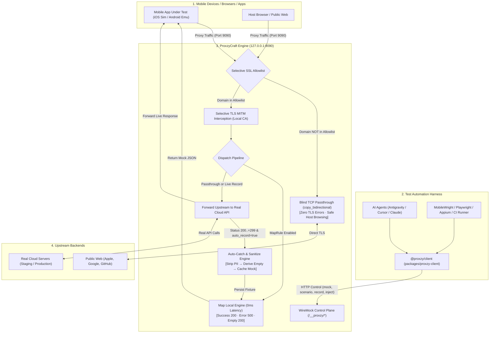

# ProxzyCraft &mdash; Safe Native Network Inspector &amp; Autonomous Mobile E2E Mock Engine

[](https://www.rust-lang.org)
[](https://tokio.rs)
[](https://github.com/emilk/egui)
[](LICENSE)
[](#privacy--security)

**ProxzyCraft** is an open-source, pure-Rust HTTP/1.1 &amp; HTTPS MITM proxy engineered for two critical use cases:
1. **Daily Developer &amp; QA Debugger (Like Proxyman / Charles):** A native Cupertino dark-mode desktop GUI (`egui`) with deep request/response inspection, 3-scenario Map Local mocking, request breakpoints, and a cURL Composer.
2. **Autonomous SDLC E2E Engine (Like WireMock for Mobile):** A headless, zero-latency in-band control plane (`127.0.0.1:9090/__proxzy/*`) that automates mobile UI testing with **MobileWright**, **`mobile-mcp`**, **Playwright**, **Appium**, and AI coding agents.

Nothing is locked behind accounts, trials, telemetry, or paid tiers &mdash; 100% free and open-source under the MIT license.

---

## 🌟 Key Highlights

* **Dual-Mode Execution:** Run the native desktop GUI with `cargo run` or start a lightweight headless daemon with `proxzy --headless`.
* **Auto-Catch Live 200 OK (Zero-Mock Cold Start):** When starting tests for a new app without existing mock data, ProxzyCraft intercepts live 200 responses from trusted backends, scrubs PII/tokens, derives empty states, and caches them as mock fixtures for instant offline replay.
* **3-Scenario Map Local State Machine:** Every mock stores `Success (200)`, `Error (500)`, and `Empty (200)` scenario slots. Switch scenarios in **1 click** in the GUI or via `POST /__proxzy/scenario`.
* **Automatic Security &amp; PII Redaction:** Authorization headers, bearer tokens, passwords, 10-digit phone numbers, and citizen IDs are automatically scrubbed and replaced with safe template placeholders (`{{TOKEN}}`, `{{USERNAME}}`, `{{OTP}}`).
* **Testcase-Scoped Session Audits:** Enforce that screen play tests only record the exact domains and paths for that use case, keeping unrelated background traffic out of fixtures.
* **Version-Stamped Regression &amp; Contract Drift:** Detect `BREAKING` (missing keys) vs `ADDITIVE` (new fields) schema drifts between live APIs and versioned mocks across `preprod`, `staging`, and `prod`.
* **Dynamic Property &amp; User Injection:** Inject test credentials (phone, OTP, user tier) dynamically at test runtime via `POST /__proxzy/inject` without modifying base fixture files.
* **Universal Traffic Visibility &amp; Zero Blind Spots:** 100% of HTTP and HTTPS CONNECT connections are captured and displayed in `All Traffic` with real transferred byte counts and connection latency.
* **Open-Source Safety Policy (Protected Raw Data Binding):** Built-in risk-protection prevents TLS decryption on sensitive system endpoints (Apple APNS `*.push.apple.com`, OS Updates `swscan.apple.com`, OCSP revocation `*.digicert.com`, and Google Play Services). These connections are safely bound as raw TCP data without TLS tampering.
* **1-Click TLS Decryption:** Unlisted application domains appear as `RAW TUNNEL` rows with a 1-click `[+ Enable TLS Decryption]` action right in the Inspector &mdash; no manual domain typing required.
* **Zero-Dependency Universal SDK (`@proxzy/client`):** Drop-in TypeScript client in `packages/proxzy-client` for seamless integration into any test harness.

---

## 📐 Architecture &amp; System Flow



---

## 🚀 Getting Started

### 1. Prerequisites
* **Rust toolchain:** 1.75+ recommended ([Install Rust](https://www.rust-lang.org/tools/install))
* **macOS:** For iOS Simulator keychain integration (`xcrun simctl`)
* **Linux / Windows / macOS:** With `adb` for Android Emulators

### 2. Build &amp; Run Desktop GUI (Mode A)
```bash
# Clone the repository
git clone https://github.com/JARNBOY/ProxzyCraft.git
cd ProxzyCraft

# Run native desktop app (egui / eframe)
cargo run --manifest-path app/Cargo.toml

# Or build optimized release binary
cargo build --release --manifest-path app/Cargo.toml
```

### 3. Run Headless E2E Daemon (Mode B)
For CI/CD pipelines, Docker containers, or background automated testing:
```bash
# Start headless MITM proxy & WireMock control plane on 127.0.0.1:9090
cargo run --release --manifest-path app/Cargo.toml -- --headless

# Or enable Auto-Catch on trusted domains directly from launch:
cargo run --release --manifest-path app/Cargo.toml -- --headless --auto-record="*.example.com,api.trusted.com"
```

---

## 📱 Mobile Device &amp; Simulator Setup

ProxzyCraft generates an isolated Certificate Authority (CA) on first run:
* Certificate: `~/.proxzy/ca/ca.crt` (or `~/Library/Application Support/Proxzy/proxzy-ca.cer`)
* Private Key: `~/.proxzy/ca/ca.key` *(Stored locally; never leaves your machine)*

### iOS Simulator
1. Launch ProxzyCraft and open **Live Capture**.
2. Select your booted simulator under **Detected devices**.
3. Click **Connect & trust**. ProxzyCraft installs the root certificate into the simulator keychain via `xcrun simctl keychain <UDID> add-root-cert` automatically.

### Android Emulator
1. Select your booted emulator (e.g. `emulator-5554`) in **Detected devices**.
2. ProxzyCraft pushes the CA to `/sdcard/Download/proxzy-ca.cer` and configures the HTTP proxy to `10.0.2.2:9090`.
3. Complete installation in Android **Settings &rarr; Security &rarr; Encryption &amp; credentials &rarr; Install a certificate &rarr; CA certificate**.
*(Note: Android 7+ debug builds require a `network_security_config.xml` permitting user CA certificates).*

---

## ⚡ Cold-Start Resolution: Auto-Catch Live 200 OK

When automating UI tests for a new app without existing mock data:
1. **Enable Auto-Catch** on your trusted API domain:
   ```bash
   curl -s -X POST http://127.0.0.1:9090/__proxzy/record \
     -H "Content-Type: application/json" \
     -d '{"enabled": true, "domains": ["*.example.com", "api.sample.com"]}'
   ```
2. **Run your E2E test suite once** against staging or preprod.
3. **ProxzyCraft automatically:**
   - Intercepts live 200..=299 responses.
   - Scrubs confidential tokens and PII using `sanitize_mock_payload`.
   - Generates an empty collection fallback (`auto_derive_empty_scenario`).
   - Translates URL into an environment-agnostic wildcard pattern.
   - Caches the mock rule in memory and writes `mocks/<domain>/<method>_<slug>/success.json`.
4. **All future test runs hit the in-memory mock** with **0ms latency**, zero network flakiness, and 100% offline support.

---

## 📦 Universal Client SDK (`@proxzy/client`)

Located in [`packages/proxzy-client`](packages/proxzy-client), this zero-dependency TypeScript package lets any testing framework operate the engine.

### Installation
```bash
# In your test repository:
npm install @proxzy/client
# Or link locally from a monorepo workspace:
npm link ../ProxzyCraft/packages/proxzy-client
```

### Usage with MobileWright / Playwright
```ts
import { test, expect } from '@playwright/test';
import { ProxzyClient } from '@proxzy/client';

const proxzy = new ProxzyClient();

test('Verifies Wallet error recovery and session audit', async () => {
  // 1. Start testcase-scoped session with release & environment metadata:
  await proxzy.startSession({
    name: 'TC_WALLET_01',
    folder: 'Wallet',
    app_version: '1.1.0',
    baseline_version: '1.0.0',
    env: 'preprod',
    domains: ['api.example.com'],
    paths: ['/v1/wallet/*'] // Scopes recording strictly to this screen play
  });

  // 2. Inject test user credentials dynamically:
  await proxzy.injectUser(
    { folder: 'Auth' },
    { phone: '0812345678', otp: '111111', tier: 'Gold' }
  );

  // 3. Switch Wallet mock to Error scenario:
  await proxzy.setFolderScenario('Wallet', 'error');

  // 4. Drive screen via mobile-mcp / MobileWright:
  // await mobile.tap('#wallet-tab');
  await proxzy.expectHits('wallet/balance', 1);

  // 5. Recover to Success scenario in 1 call:
  await proxzy.setFolderScenario('Wallet', 'success');
  // await mobile.tap('#retry-button');

  // 6. Conclude session and assert audit metrics & contract drift:
  const summary = await proxzy.endSession();
  expect(summary.mock_calls).toBeGreaterThan(0);
  expect(summary.breaking_drifts).toBe(0); // Zero breaking schema changes
});
```

---

## 🌐 WireMock-Like REST Control Plane (`/__proxzy/*`)

External frameworks (XCTest, Espresso, Python, Shell) can control ProxzyCraft directly over `127.0.0.1:9090`:

| Endpoint | Method | Description |
| :--- | :--- | :--- |
| `/__proxzy/health` | `GET` | Returns engine status, active rules, hit counts, and SSL allowlist. |
| `/__proxzy/record` | `POST` | Toggles Auto-Catch live 200 OK mode and updates trusted domains. |
| `/__proxzy/mock` | `POST` | Upserts a 3-scenario mock rule (from wildcard pattern or cURL) with optional `app_version` and `env`. |
| `/__proxzy/scenario` | `POST` | Switches rule or folder to `success`, `error`, `empty`, or `passthrough`. |
| `/__proxzy/inject` | `POST` | Injects dynamic template values (`{{KEY}}`) without altering base mocks. |
| `/__proxzy/session/start` | `POST` | Starts a testcase-scoped audit session with `app_version`, `baseline_version`, `env`, and path filters. |
| `/__proxzy/session/summary` | `GET` | Returns real-time audit summary (`mock_calls`, `upstream_calls`, `breaking_drifts`, `additive_drifts`). |
| `/__proxzy/session/end` | `POST` | Closes active session, produces final audit report, and flushes session state. |
| `/__proxzy/reset` | `POST` | Resets hit counters and clears session state (or deletes all rules if `clear_rules: true`). |

---

## 🔍 Version-Stamped Multi-Env Regression &amp; Contract Drift

ProxzyCraft features pure-Rust, zero-dependency JSON schema drift detection:
* **Breaking Drifts (`missing_in_live`):** Live API omitted or altered an expected field present in mock fixtures &rarr; flags critical QA regressions that can crash the mobile UI.
* **Additive Drifts (`added_in_live`):** Live API introduced new fields not yet defined in baseline mocks &rarr; flags non-breaking evolutions for mock fixture updates.
* **Multi-Version Directory Hierarchy:** Fixtures automatically scale cleanly across environments without collision:
  `mocks/<env>/v<version>/<domain>/<method>_<slug>/<scenario>.json`
  *(e.g., `mocks/preprod/v1.1.0/api.example.com/get_v1_wallet_balance/success.json`)*

---

## 🛡️ Privacy &amp; Security Guarantees

* **100% Local Execution:** No cloud accounts, remote telemetry, or phone-home requests.
* **PII &amp; Token Masking:** Sensitive data (JWTs, passwords, phones, citizen IDs) are never committed to mock fixtures.
* **Loopback Security:** Control plane on `/__proxzy/*` validates loopback origins and rejects untrusted external traffic with HTTP 403.
* **Selective Interception:** Untrusted or unlisted host HTTPS traffic passes through untouched without certificate warnings.

---

## 🧪 Testing the Codebase

Verify changes to the Rust engine:
```bash
cargo test --manifest-path app/Cargo.toml
```

Verify the TypeScript client SDK:
```bash
node --experimental-strip-types packages/proxzy-client/test/smoke.ts
```

---

## 📄 License

This project is licensed under the [MIT License](LICENSE) &copy; 2026 Papon Supamongkonchai (JARNBOY).
