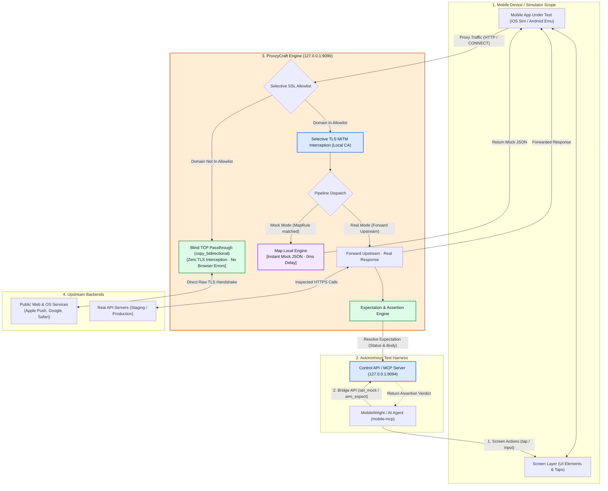

# ProxzyCraft &mdash; Safe Native Network Inspector &amp; Mobile Testing Bridge

[](https://www.rust-lang.org)
[](https://tokio.rs)
[](https://github.com/emilk/egui)
[](LICENSE)
[](#privacy--security)

**ProxzyCraft** is a lightweight, pure-Rust network proxy and inspection tool built for developers, QA engineers, and autonomous mobile testing agents. It combines a real HTTP/1.1 &amp; HTTPS MITM intercepting engine with immediate-mode GUI (`egui`), Map Local response mocking, request/response breakpoints, automatic iOS Simulator/Android Emulator certificate management, and an autonomous bridge for **MobileWright / `mobile-mcp`**.

Nothing is locked behind accounts, trials, telemetry, or paid tiers &mdash; 100% free and open-source.

---

## Architecture &amp; System Flow (`/diagram-design`)



---

## Dual-Mode Mobile Bridge (MobileWright &amp; `mobile-mcp`)

When running automated UI tests with tools like **`mobile-mcp`** or **MobileWright**, ProxzyCraft provides dual-channel network orchestration:

### 1. Mock Mode (Map Local &mdash; Screen Play Only)
* **Purpose:** Drive mobile screen navigation with 100% deterministic, zero-latency mocked data without hitting real backend servers.
* **Flow:**
  1. Test script or AI agent calls `proxzy_set_mock({ pattern: "*/v1/wallet", status: 200, body: "{'balance': 0}" })`.
  2. `mobile-mcp` triggers a screen action (e.g. taps the "Wallet" tab).
  3. ProxzyCraft intercepts the call, short-circuits the connection, and immediately delivers the mock JSON with `x-proxzy-rule`.
  4. **Zero network packets leave the machine.** The screen displays the empty state instantly without backend flakiness.

### 2. Real Mode (Testful Catch &amp; Expectation Assertion)
* **Purpose:** Pass traffic to live staging or production servers while verifying that the mobile app sent the exact required payload.
* **Flow:**
  1. Agent arms an expectation: `proxzy_arm_expectation({ url_pattern: "*/api/v2/checkout", method: "POST" })`.
  2. `mobile-mcp` taps "Confirm Payment $99" on screen.
  3. ProxzyCraft catches `POST /api/v2/checkout`, records the request payload (`{"amount": 99}`), forwards to the real server, captures the real response (`201 Created`), and returns it to the app.
  4. Agent calls `proxzy_wait_expectation()`, obtaining the full request/response transaction for immediate schema and contract assertion.

---

## How to Use: Mock &amp; Testful UI Test Workflow (`127.0.0.1:9090`)

### 1. Direct URL or Domain Rule Hook (No cURL Required)
When configuring a Mobile UI Test (`127.0.0.1:9090`) and you **do not have a cURL command**, open **Map Local** and use the top **DIRECT URL / cURL HOOK** bar:
1. Choose the HTTP method (`ANY`, `GET`, `POST`, `PUT`, `DELETE`).
2. Enter a **direct URL** (e.g., `https://api.mycorp.com/v1/orders*`) or a **domain/path wildcard** (`*/v1/checkout*`).
3. Pick the initial scenario pill: **`Success`** (`200`), **`Error`** (`500`), or **`Empty`** (`200`).
4. Edit the inline `Return JSON` payload (or keep the preset template) and click **`+ Hook Mock`**.
5. **Automatic Device Test Sync:** ProxzyCraft automatically enables the Map Local engine, extracts the hostname (`api.mycorp.com`), and registers it in the **SSL Proxying Allowlist** so HTTPS requests from iOS Simulator or Android Emulator are intercepted and answered immediately.

### 2. Paste cURL Import &amp; Live Upstream-to-Mock Recording (Postman + Proxyman Flow)
1. Open **Composer** (or the **New Mapping** modal in **Map Local**).
2. Paste any `curl -X POST 'https://...' -H '...' -d '{...}'` command into the **PASTE cURL / DIRECT URL** bar.
3. Click **`Import & Send`** to call the real upstream Production/Staging API and inspect the live status, headers, and JSON body.
4. Click **`Save Response as Mock`** in the Response panel to turn that real upstream response into the **`Success (200)`** scenario of a new Map Local rule in 1 click.

### 3. Multi-Scenario Variants (`Success` / `Error` / `Empty`) &amp; Fixture Path Convention
Every Map Local rule stores three independent scenario payloads in memory so you can switch states in **1 click** without re-typing JSON:
* **`Success (200)`** &mdash; Happy-path payload (or recorded upstream response).
* **`Error (500/503)`** &mdash; Server failure payload to test mobile error banners and retry buttons.
* **`Empty (200)`** &mdash; Empty collection payload (`{"items":[],"data":[],"total":0}`) to test empty-state screens.

Each rule displays and copies its canonical, scalable fixture path convention:
```text
mocks/<domain>/<method>_<path_slug>/<scenario>.json
# Example:
mocks/api.shopwave.dev/get_v1_orders/success.json
mocks/api.shopwave.dev/get_v1_orders/error.json
mocks/api.shopwave.dev/get_v1_orders/empty.json
```

### 4. WireMock / Testful HTTP Control Hook API (`/__proxzy/*`)
External test runners (**MobileWright**, **`mobile-mcp`**, **XCTest**, **Espresso**, or shell scripts) can control and verify ProxzyCraft directly over the same proxy port (`127.0.0.1:9090`) with zero extra daemon configuration:

```bash
# 1. Verify proxy sync, active SSL allowlist, and rule hit counts
curl -s http://127.0.0.1:9090/__proxzy/health

# 2. Dynamically inject or update a mock rule (auto-whitelists HTTPS domain!)
curl -s -X POST http://127.0.0.1:9090/__proxzy/mock \
  -d '{"pattern":"https://api.shopwave.dev/v1/orders*","method":"GET","scenario":"success","status":200,"body":"{\"orders\":[{\"id\":\"ord_1\"}]}"}'

# 3. Switch an endpoint between "success", "error", "empty", or "passthrough" (real upstream)
curl -s -X POST http://127.0.0.1:9090/__proxzy/scenario \
  -d '{"pattern":"https://api.shopwave.dev/v1/orders*","scenario":"error"}'

# 4. Reset all mock hit counters before the next test case
curl -s -X POST http://127.0.0.1:9090/__proxzy/reset
```

---

## Selective SSL Proxying (Browser Protection)

Traditional MITM proxies terminate TLS on every single connection, causing host browsers (Chrome, Safari, macOS services) to break with `NET::ERR_CERT_AUTHORITY_INVALID`.

ProxzyCraft enforces **Selective SSL Interception**:
* **Default Safe Mode:** If the SSL allowlist is empty, **100% of HTTPS connections undergo Blind TCP Passthrough** (`tokio::io::copy_bidirectional`).
* **Targeted Interception:** Only domains explicitly present in your allowlist (e.g., `*.myapi.com`, `api.github.com`) have dynamic leaf certificates minted.
* **Zero Host Lockout:** Public browsers, Spotify, Apple Push Services, and Slack continue to communicate directly with zero certificate errors.

---

## Key Features

| Feature | Description |
| :--- | :--- |
| **Live Proxy Engine** | Asynchronous HTTP/1.1 &amp; HTTPS MITM proxy listening on `127.0.0.1:9090` (falls back to 9091&ndash;9093). Powered by Tokio and Rustls. |
| **All Traffic View** | Live stream showing HTTP method, status pill, API kind (REST, GraphQL, Media), latency, and payload size. |
| **Deep Inspector** | Inspect Overview, Request, Response, Headers, and cURL commands. Response bodies switch between formatted **JSON**, **Raw**, **XML**, and **HTML**. |
| **Map Local Engine** | Answers matching requests with local JSON, custom HTTP status, response headers, and delay injection (0&ndash;10,000ms). |
| **Breakpoints** | Pause live requests before they hit the wire. Modify URL, headers, and request body, or abort the request. |
| **Request Composer** | Craft and dispatch custom REST or GraphQL requests through the system proxy with built-in presets. |
| **Device Auto-Setup** | Automatically detects booted iOS Simulators and Android Emulators/devices. Installs certificates with a single click via `xcrun simctl` and `adb`. |
| **Log Dashboard** | Integrated timeline for system events, CA operations, mock hits, and connection errors with copyable session summaries. |

---

## Getting Started

### Prerequisites
* [Rust](https://www.rust-lang.org/tools/install) (1.75+ recommended)
* macOS (for iOS Simulator keychain integration) or Linux/Windows with `adb` (for Android)

### Run Desktop GUI
```bash
# Navigate to the app directory
cd app

# Run ProxzyCraft in development mode
cargo run

# Build an optimized release binary
cargo build --release
```

### Headless &amp; MCP Daemon Modes (CI/CD &amp; Agents)
ProxzyCraft's proxy engine is completely decoupled from the GUI and can run headlessly:
```bash
# Run headlessly as an MCP server for Cursor, Claude, or Antigravity
cargo run -- --mcp

# Run in headless daemon mode on custom ports
cargo run -- --headless --proxy-port 9090 --control-port 9094
```

### Visual &amp; Demo Flags
```bash
# Capture an automated screenshot of the window and exit
cargo run -- --screenshot shots/now.png

# Open specific tabs directly
PROXZY_VIEW=map cargo run          # Map Local
PROXZY_VIEW=breakpoints cargo run  # Breakpoints
PROXZY_VIEW=logs cargo run         # Log Dashboard
PROXZY_VIEW=composer cargo run     # Composer
PROXZY_VIEW=guide cargo run        # Guide & Stack
```

---

## Device Certificate Setup

The proxy generates a unique local Certificate Authority upon first launch:
* Certificate: `~/Library/Application Support/Proxzy/proxzy-ca.cer`
* Public PEM: `~/Library/Application Support/Proxzy/proxzy-ca.pem`
* Private Key: `~/Library/Application Support/Proxzy/proxzy-ca-key.pem` *(Never leaves your machine)*

### iOS Simulator
1. Start the proxy in ProxzyCraft.
2. In **Live Capture**, select your booted simulator under **Detected devices**.
3. Click **Connect…** &rarr; **Connect and trust**.
4. Proxzy automatically installs the CA via `xcrun simctl keychain <UDID> add-root-cert` and restarts the simulator so the new trust store loads.

### Android Emulator
1. Select your booted emulator (e.g. `emulator-5554`) in **Detected devices**.
2. Click **Connect…** &rarr; confirms copying the CA to `/sdcard/Download/proxzy-ca.cer` and sets global HTTP proxy to `10.0.2.2:9090`.
3. Complete installation under **Settings &rsaquo; Security &rsaquo; Encryption &amp; credentials &rsaquo; Install a certificate &rsaquo; CA certificate**.
*(Note: Android 7+ apps require a debug build permitting user CA certificates in `network_security_config.xml`).*

---

## Privacy &amp; Security

* **Zero Cloud Dependency:** ProxzyCraft runs 100% locally on your machine.
* **No Telemetry / No Phone Home:** No tracking scripts, analytics SDKs, accounts, or remote servers.
* **Key Isolation:** The local CA private key is stored strictly in your user Application Support directory and is never embedded in Git or shared.

---

## License

This project is licensed under the [MIT License](LICENSE) &copy; 2026 Papon Supamongkonchai (JARNBOY).

