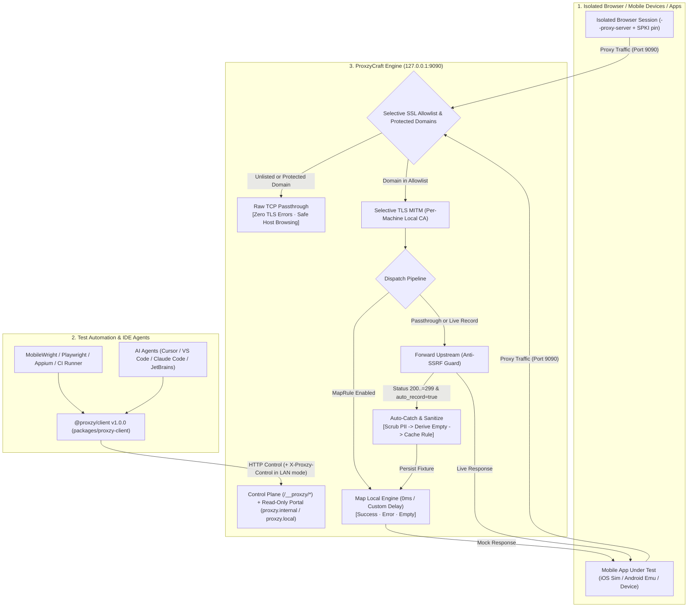

# ProxzyCraft v1.0.1 &mdash; Safe Native Network Inspector &amp; Autonomous E2E Mock Engine

[](app/Cargo.toml)
[](https://www.rust-lang.org)
[](https://tokio.rs)
[](https://github.com/emilk/egui)
[](LICENSE)
[](PRIVACY.md)

**ProxzyCraft** is a free, zero-telemetry, pure-Rust HTTP/1.1 &amp; HTTPS MITM proxy and deterministic E2E API scenario engine built for:
1. **Desktop &amp; Mobile Debugging:** A native Cupertino dark-mode GUI (`egui`) with an **Isolated Browser Session** launcher (zero system-wide proxy or keychain mutations), iOS Simulator / Android Emulator auto-detection, request breakpoints, a REST/GraphQL Composer, and a 3-scenario Map Local mock engine.
2. **Autonomous SDLC &amp; AI Agent E2E:** A headless, zero-latency in-band Control Plane (`127.0.0.1:9090/__proxzy/*`) and zero-dependency TypeScript client (`@proxzy/client` v1.0.0) for **MobileWright**, **`mobile-mcp`**, **Playwright**, **Appium**, **XCTest**, **Espresso**, and AI coding agents (Cursor, VS Code, Claude Code, JetBrains).

Nothing is locked behind accounts, trials, telemetry, or paid tiers &mdash; 100% free and open-source under the [MIT License](LICENSE).

---

## Key Highlights

- **Isolated Browser Session (Zero Host Pollution):** Launch Chrome, Chromium, Brave, or Microsoft Edge with `--proxy-server`, a temporary `--user-data-dir`, and `--ignore-certificate-errors-spki-list=<SPKI>` using your local CA's **SPKI Fingerprint** &mdash; inspecting HTTPS without changing macOS `networksetup` or installing a Root CA in your global keychain.
- **Standards-Aligned Virtual Certificate Portal:** Access read-only CA downloads at `http://proxzy.internal/` (ICANN-reserved `.internal` private-use TLD) or `http://proxzy.local/` (plus `http://127.0.0.1:<port>/` or your LAN IP when LAN access is enabled) via `/`, `/ca.cer`, `/ca.pem`, and `/ssl`.
- **Safe-by-Default Selective Interception:** When `ssl_allowlist` is empty, `ProxyConfig::should_intercept` returns `false` and all `CONNECT` tunnels pass through as raw opaque tunnels (`Tunnel` rows). Built-in `BUILTIN_PROTECTED_DOMAINS` permanently exclude Apple APNs, OS updates, OCSP/CRL revocation, and Google Play Services from TLS decryption.
- **Auto-Catch Live 200 OK (Zero-Mock Cold Start):** Intercept live `200..=299` responses, automatically scrub tokens, passwords, OTPs, phones, and IDs (`sanitize_mock_payload`), derive `Empty` collection fallbacks, and persist versioned fixtures.
- **3-Scenario Map Local State Machine:** Every Map Rule stores `Success`, `Error`, and `Empty` scenarios plus `passthrough`, with 1-click GUI switching, per-slot customization, simulated latency (`delay_ms`), and runtime template injection (`{{TOKEN}}`, `{{OTP}}`).
- **Version-Stamped Contract Drift:** Pure-Rust JSON schema diffing detects `Breaking` (missing/type-changed keys) and `Additive` (new keys) changes across `preprod`, `staging`, and `prod`.
- **LAN Control Token Security:** Binds strictly to `127.0.0.1` by default (`BindPolicy::LoopbackOnly`). Opt-in `--lan` or **Allow LAN devices** enforces CSPRNG `X-Proxzy-Control` / `Authorization: Bearer` tokens (`control.token`, `0o600`), zero CORS, and anti-SSRF upstream guards.

---

## Zero-Cost Open-Source Distribution &amp; Gatekeeper Note

ProxzyCraft v1.0.0 is distributed at **$0** under the MIT license:

- **Recommended (Zero Gatekeeper Friction): Build from Source**
  ```bash
  git clone https://github.com/JARNBOY/ProxzyCraft.git
  cd ProxzyCraft
  cargo build --release --manifest-path app/Cargo.toml
  ```
- **Prebuilt GitHub Releases (Unsigned OSS Binaries):**
  - Prebuilt macOS, Linux, and Windows binaries published on GitHub Releases include `SHA256SUMS.txt` checksums.
  - Because ProxzyCraft is a **$0 community OSS project** (without a paid $99/year Apple Developer ID notarization or Mac App Store sandbox — MAS Guideline 2.4.5 conflicts with developer proxy workflows like `xcrun simctl`, `adb`, and opt-in `networksetup`), macOS Gatekeeper may warn on downloaded `.tar.gz`/`.zip`/`.app` archives.
  - Always verify `SHA256SUMS.txt` first; on macOS, either build from source or explicitly allow via *System Settings &rarr; Privacy &amp; Security &rarr; Open Anyway*. See [`SECURITY.md`](SECURITY.md) for details.

---

## Architecture &amp; System Flow



---

## Getting Started

### Prerequisites

- **Rust toolchain:** 1.75+ ([Install Rust](https://www.rust-lang.org/tools/install))
- **Node.js 22+ &amp; npm** (optional, for `@proxzy/client` typecheck and E2E/smoke tests)
- **macOS (`xcrun simctl`)** for iOS Simulator keychain automation; **`adb`** for Android Emulators/Devices

### Run the Desktop GUI

```bash
git clone https://github.com/JARNBOY/ProxzyCraft.git
cd ProxzyCraft

# Launch native desktop app (egui / eframe)
cargo run --manifest-path app/Cargo.toml

# Or build optimized release binary at target/release/proxzy
cargo build --release --manifest-path app/Cargo.toml
```

### Run Headless E2E Daemon &amp; CLI Flags

```bash
# Start headless MITM proxy & control plane on 127.0.0.1:9090
cargo run --release --manifest-path app/Cargo.toml -- --headless

# Enable Auto-Catch on trusted API domains from launch
cargo run --release --manifest-path app/Cargo.toml -- --headless --auto-record="*.example.com,api.trusted.com"
```

Supported CLI flags (`app/src/main.rs`):

| Flag | Alias / Form | Description |
| :--- | :--- | :--- |
| `--headless` | `-d`, `--daemon` | Run without the GUI window as a headless daemon. |
| `--port <PORT>` | `--port=<PORT>` | Proxy &amp; control plane listening port (default `9090`). |
| `--lan` | &mdash; | Opt in to LAN listening (`0.0.0.0:<port>`). Requires `X-Proxzy-Control` token from non-loopback peers. |
| `--bind <IP>` | `--bind=<IP>` | Bind to an explicit IP address. |
| `--control-token <TOK>` | `--control-token=<TOK>` | Supply an explicit control token instead of auto-generating `control.token`. |
| `--auto-record` | `--auto-record=<d1,d2>` | Enable Auto-Catch live `200 OK` recording and optionally whitelist domains. |
| `--full-catch` | &mdash; | Enable full HTTPS catch (while keeping `BUILTIN_PROTECTED_DOMAINS` tunnelled). |

---

## Desktop Screens &amp; Capabilities (v1.0.0)

ProxzyCraft includes **12 screens** across the left navigation rail (`Traffic`, `Monitor`, `Automation & agents`, `Tools`, and `Start here`) plus a built-in Command Palette:

| Group | Screen | What It Does |
| :--- | :--- | :--- |
| **Start here** | **Tutorial** | 14-stop interactive guided tour overlay that switches directly to every screen (including Live Capture, Agent Control, Hook an IDE, and ACP Bridge). |
| **Traffic** | **All Traffic** | Live feed with filters (`All`, `Live`, `Pinned`, `GraphQL`, `REST API`, `Errors`, `Mocked`, `Tunnels`) and right-hand Inspector (`Overview`, `Request`, `Response`, `Headers`, `cURL`), `Repeat`, `Mock this`, `Share`, and 1-click `[+ Enable TLS Decryption]` on `Tunnel` rows. |
| **Monitor** | **Log Dashboard** | Unified session timeline for captures, mock hits, breakpoint stops, and system events with KPI cards, top hosts, `Info`/`Warn`/`Error` filters, and `Copy summary`. |
| **Automation &amp; agents** | **Agent Control** + **Hook an IDE** | Live `/__proxzy/*` control-plane event feed, quick scenario &amp; property injection controls, plus 1-paste **Hook an IDE** briefs for **Cursor**, **VS Code**, **Claude Code**, and **JetBrains** (carrying active port, CA path, and `X-Proxzy-Control` token when LAN is enabled). |
| **Automation &amp; agents** | **ACP Bridge** | Interactive concept lab illustrating the **Agent Client Protocol (ACP v1, JSON-RPC 2.0 over `stdio`)** editor-to-agent handshake (`initialize` &rarr; `session/new` &rarr; `session/prompt` &amp; permission gate) alongside MCP tool calls. |
| **Automation &amp; agents** | **API Test Bench** | Execute saved REST and GraphQL requests through the Map Local mock engine with pinned expected status/hit verdicts and JSON suite import/export. |
| **Automation &amp; agents** | **Screen Play &amp; MCP** | Run scripted flows mixing real engine steps (`Scenario`, `Inject`, real-traffic `Hit` checkpoints) with simulated device steps (`Tap`, `Type`, `ExpectVisible`) and JSON export. |
| **Tools** | **Live Capture** | **Isolated Browser Session** 1-click launcher + SPKI Fingerprint copy + Firefox/Playwright/curl snippets, iOS Simulator &amp; Android Emulator/Device detection (`UsbReverse` / `WifiLan`), opt-in Mac `networksetup` toggle (with confirmation &amp; quit-restore), `Allow LAN devices` toggle, and SSL Allowlist / Safe Mode controls. |
| **Tools** | **Composer** | Postman-style REST &amp; GraphQL request builder with cURL import, JSON/Raw/XML/HTML response viewer, and **Save Response as Mock** (`Success` / `Error` / `Empty`). |
| **Tools** | **Map Local** | Manage Map Rules via Table or Pipeline view, Direct URL / cURL Hook bar, 3-scenario switching (`Success`, `Error`, `Empty`, `Passthrough`), dynamic `{{VAR}}` injection, and versioned fixture drift inspection. |
| **Tools** | **Breakpoints** | Arm catch rules to pause live matching requests or responses, edit method/URL/headers/body in flight, and click **Continue** or **Abort**. |
| **Tools** | **Guide &amp; Stack** | Reference guide covering Isolated Browser Session setup, mobile CA provisioning, Root CA removal, and the pure-Rust stack. |

---

## Isolated Browser Session &amp; Mobile Onboarding

### 1. Desktop Web (Recommended: Isolated Browser Session)

In **Live Capture** or **Guide &amp; Stack**, click **Launch Isolated Browser** (or copy the generated CLI command). ProxzyCraft discovers Google Chrome, Chromium, Brave, or Microsoft Edge and launches it with:
- `--proxy-server=http://127.0.0.1:<port>`
- `--user-data-dir=<temp-dir>/proxzy-browser-<port>`
- `--ignore-certificate-errors-spki-list=<BASE64_SHA256_SPKI>`

Your personal browser profile, system Wi-Fi proxy (`networksetup`), and macOS login keychain remain completely untouched. **Firefox** (`firefox -P proxzy-test -no-remote` + `http://proxzy.internal/`) and **Playwright** (`proxy` + SPKI args) snippets are also generated ready to copy.

### 2. Virtual Certificate Portal

When a browser or device routes HTTP traffic through ProxzyCraft, you can download the public CA certificate without touching public DNS:
- `http://proxzy.internal/` (or `/ca.cer`, `/ca.pem`, `/ssl`)
- `http://proxzy.local/` (or `/ca.cer`, `/ca.pem`, `/ssl`)
- `http://127.0.0.1:<port>/` (or `http://<lan-ip>:<port>/` when LAN mode is enabled)

### 3. iOS Simulator &amp; Android Emulator / Device

ProxzyCraft generates your unique per-machine CA once under `~/Library/Application Support/Proxzy/` (`proxzy-ca.pem`, `proxzy-ca.cer`, `proxzy-ca-key.pem` with `0o600` permissions):
- **iOS Simulator:** Click **Install in booted simulator** in **Live Capture** (uses `xcrun simctl keychain <UDID> add-root-cert`).
- **Android Emulator / Device:** Choose **USB (`adb reverse`)** (`UsbReverse`) or **Wi-Fi LAN** (`WifiLan`). ProxzyCraft pushes `proxzy-ca.cer` to `/sdcard/Download/proxzy-ca.cer` and configures `adb shell settings put global http_proxy ...` (debug builds on Android 7+ require a `network_security_config.xml` permitting user CAs).

---

## Control Plane (`/__proxzy/*`) &amp; LAN Security

When running locally, loopback callers (`127.0.0.1` / `::1`) can call `/__proxzy/*` directly. When `--lan` or **Allow LAN devices** is enabled, non-loopback callers must provide the token from `~/Library/Application Support/Proxzy/control.token` in `X-Proxzy-Control: <token>` or `Authorization: Bearer <token>`. Control routes are always denied inside decrypted HTTPS tunnels (`!is_tls`) and reject browser `Origin` headers.

| Endpoint | Method | Description |
| :--- | :--- | :--- |
| `/__proxzy/health` | `GET` | Also `/__proxzy/status` and `/__proxzy`. Returns engine status, `auto_record`, `ssl_allowlist`, active rules, and hit counts. |
| `/__proxzy/record` | `POST` | Toggles Auto-Catch (`{"enabled": true, "domains": [...]}`) and registers domains in `ssl_allowlist`. |
| `/__proxzy/mock` | `POST` | Upserts a 3-scenario Map Rule from `pattern`/`url` or `curl` command, supporting `method`, `folder`, `scenario`, `status`, `body`, per-slot `success_status`/`success_body`/`error_status`/`error_body`/`empty_status`/`empty_body`, `delay_ms`, `app_version`, `env`, `sanitize`, and `inject`. |
| `/__proxzy/scenario` | `POST` | Switches matching `pattern` or `folder` to `success`, `error`, `empty`, or `passthrough`. |
| `/__proxzy/inject` | `POST` | Injects dynamic template values (`{{KEY}}`) into matching `pattern` or `folder` rules. |
| `/__proxzy/session/start` | `POST` | Starts a testcase-scoped audit session (`name`, `folder`, `app_version`, `baseline_version`, `env`, `domains`, `paths`). |
| `/__proxzy/session/summary` | `GET` | Returns real-time audit counts (`mock_calls`, `upstream_calls`, `breaking_drifts`, `additive_drifts`, `calls`). |
| `/__proxzy/session/end` | `POST` | Ends the active session and returns the final audit report. |
| `/__proxzy/reset` | `POST` | Resets hit counters and injected properties, or deletes all Map Rules and disables mocking when `{"clear_rules": true}` is passed. |

---

## Universal TypeScript SDK (`@proxzy/client` v1.0.0)

Located in [`packages/proxzy-client`](packages/proxzy-client) with zero runtime dependencies:

```ts
import { ProxzyClient } from '@proxzy/client';

const proxzy = new ProxzyClient({
  baseUrl: 'http://127.0.0.1:9090',
  // Optional for LAN callers (or set PROXZY_CONTROL_TOKEN env var):
  // controlToken: process.env.PROXZY_CONTROL_TOKEN,
  // allowRemoteControl: true,
});

await proxzy.startSession({
  name: 'TC_WALLET_01',
  folder: 'Wallet',
  app_version: '1.1.0',
  baseline_version: '1.0.0',
  env: 'preprod',
  domains: ['api.example.com'],
  paths: ['/v1/wallet/*'],
});

await proxzy.mock({
  pattern: 'https://api.example.com/v1/wallet/balance*',
  folder: 'Wallet',
  success_status: 200,
  success_body: { balance: 1500, user: '{{USERNAME}}' },
  error_status: 500,
  error_body: { error: 'wallet_unavailable' },
  delay_ms: 15,
});

await proxzy.inject({ folder: 'Wallet', inject: { USERNAME: 'alice' } });
await proxzy.setFolderScenario('Wallet', 'error');
// ... drive UI ...
await proxzy.setFolderScenario('Wallet', 'success');
await proxzy.expectHits('wallet/balance', 1);

const summary = await proxzy.endSession();
await proxzy.reset(true); // clears rules + injected props
```

---

## Privacy, Governance &amp; Root CA Removal

- **Zero Telemetry &amp; Data Policy:** [`PRIVACY.md`](PRIVACY.md)
- **Threat Model &amp; Security Policy:** [`SECURITY.md`](SECURITY.md)
- **Third-Party Permissive Licenses (169 Crates, 0 Copyleft):** [`THIRD_PARTY_NOTICES.md`](THIRD_PARTY_NOTICES.md)
- **Contributing Guidelines:** [`CONTRIBUTING.md`](CONTRIBUTING.md)
- **Code of Conduct:** [`CODE_OF_CONDUCT.md`](CODE_OF_CONDUCT.md)

**Quick Root CA Removal:**
- **Isolated Browser Session:** Leaves zero keychain or OS proxy changes &mdash; simply close the browser window.
- **macOS Keychain (if manually trusted):**
  ```bash
  security delete-certificate -c "Proxzy Local CA" ~/Library/Keychains/login.keychain-db
  ```
  See [`PRIVACY.md`](PRIVACY.md#4-complete-root-ca-removal--cleanup-instructions) for iOS Simulator, physical iOS, Android, Linux, and Windows cleanup commands.

---

## Testing &amp; Full v1.0.0 Regression

Run the Rust unit &amp; integration suite:
```bash
cargo test --manifest-path app/Cargo.toml
```

Run the TypeScript SDK typecheck &amp; smoke tests:
```bash
npm --prefix packages/proxzy-client run typecheck
node --experimental-strip-types packages/proxzy-client/test/smoke.ts
```

Run the unified v1.0.0 pre-release regression gate (Rust suite + TypeScript checks &amp; live headless E2E via `@proxzy/client` + clean-room export verification via [`scripts/export-clean-release.sh`](scripts/export-clean-release.sh)):
```bash
./scripts/regression-v1.sh
```

---

## License

This project is licensed under the [MIT License](LICENSE) &copy; 2026 Papon Supamongkonchai (JARNBOY).
