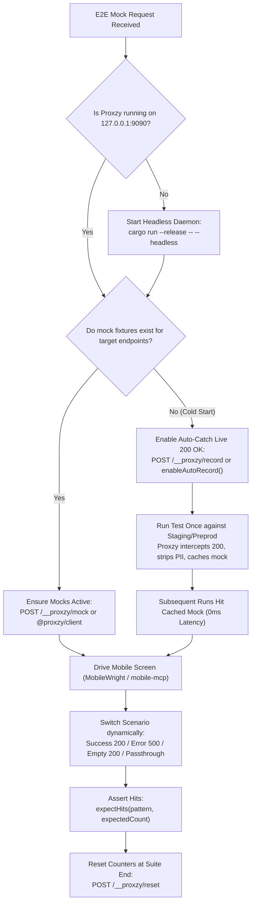

# ProxzyCraft Universal E2E Mocking & Automation Skill

This skill guides AI agents (Antigravity, Cursor, Claude Code, CI bots) through bootstrapping, configuring, and driving the **ProxzyCraft** local proxy engine (`127.0.0.1:9090`) for any E2E UI testing project, even when the project has **never set up mocking conventions before**.

---

## 1. Quick Decision Flow for AI Agents



---

## 2. Step-by-Step AI Execution Guide

### Step 1: Healthcheck & Daemon Bootstrapping
Before running test commands, check if ProxzyCraft is already active:
```bash
curl -s http://127.0.0.1:9090/__proxzy/health
```
- If response is `{"ok":true,...}`, engine is ready.
- If connection refused, spawn the daemon in the background:
  ```bash
  # Inside ProxzyCraft repo or via path to app/Cargo.toml:
  cargo run --release --manifest-path <path-to-ProxzyCraft>/app/Cargo.toml -- --headless
  ```

### Step 2: Configure Mobile Simulator / Device Proxy
Ensure target mobile simulator or physical device sends traffic to `127.0.0.1:9090`:
- **iOS Simulator**: Uses macOS host proxy or:
  ```bash
  networksetup -setwebproxy Wi-Fi 127.0.0.1 9090
  networksetup -setsecurewebproxy Wi-Fi 127.0.0.1 9090
  ```
- **Android Emulator**:
  ```bash
  adb shell settings put global http_proxy 127.0.0.1:9090
  ```
- **Root CA Certificate**: Located at `~/.proxzy/ca/ca.crt`. (Simulators automatically trust it once added to keychain via `xcrun simctl keychain <UDID> add-root-cert ~/.proxzy/ca/ca.crt`).

### Step 3: Cold-Start Resolution (When No Mocks Exist Yet)
When testing a new app with zero pre-existing mock files:
1. Enable Auto-Catch for the app's trusted API domains:
   ```bash
   curl -s -X POST http://127.0.0.1:9090/__proxzy/record \
     -H "Content-Type: application/json" \
     -d '{"enabled": true, "domains": ["*.example.com", "api.sample.com"]}'
   ```
2. Run the test suite once against staging or preprod.
3. ProxzyCraft automatically:
   - Captures live 200..=299 responses.
   - Scrubs all PII, tokens, passwords, and citizen IDs using `sanitize_mock_payload`.
   - Generates empty state fallback (`auto_derive_empty_scenario`).
   - Normalizes domain into wildcard pattern (`make_environment_wildcard_pattern`).
   - Caches the mock rule in memory and writes `mocks/<domain>/<method>_<slug>/success.json`.
4. All future runs hit the local mock with **0ms latency** and **zero network flakiness**!

### Step 4: Programmatic Control with `@proxzy/client`
In any TypeScript E2E suite (MobileWright, Playwright):

```ts
import { ProxzyClient } from '@proxzy/client';
const proxzy = new ProxzyClient();

// 1. Seed or update mock
await proxzy.mock({
  pattern: 'https://api.example.com/v1/wallet/balance*',
  folder: 'Wallet',
  scenario: 'success',
  success_status: 200,
  success_body: { balance: 5000, currency: 'USD' },
  error_status: 500,
  error_body: { error: 'upstream_timeout' },
  empty_status: 200,
  empty_body: { balance: 0, items: [] },
});

// 2. Switch to Error scenario before UI action
await proxzy.setFolderScenario('Wallet', 'error');

// 3. Drive screen via mobile-mcp / MobileWright
await mobile.tap('#balance-refresh');

// 4. Assert request hit count
await proxzy.expectHits('wallet/balance', 1);

// 5. Recover to Success scenario
await proxzy.setFolderScenario('Wallet', 'success');
```

### Step 5: Dynamic Parameter Injection (`injectUser`)
Never commit real test credentials into git. Use dynamic injection to substitute tokens and phone numbers on-the-fly:

```ts
await proxzy.injectUser(
  { folder: 'Auth' },
  {
    phone: '0812345678',
    username: 'test_user_01',
    otp: '111111',
  }
);
```

### Step 6: Testcase-Scoped Session Audit & API Contract Regression Drift

To guarantee that auto-recording **only captures the application's domain + path for that specific QA screen play** (and never unrelated public web traffic), and to verify whether the test ran on Mock or Real Prod:

```ts
// 1. Start scoped session at test begin:
await proxzy.startSession({
  name: 'TC_WALLET_01_BALANCE',
  folder: 'Wallet',
  domains: ['api.example.com'],
  paths: ['/v1/wallet/*'] // Scoped strictly to this screen play's API paths!
});

// 2. Execute MobileWright Screen Play:
await mobile.tap('#wallet-tab');

// 3. End session and verify audit trail:
const summary = await proxzy.endSession();
console.log('Test Execution Audit:', summary);

// Assert that the test passed against mock (no leak to real production):
expect(summary.mock_calls).toBeGreaterThan(0);
expect(summary.upstream_calls).toBe(0);

// If testing in Real Upstream Mode, assert zero contract drift from expected schema:
expect(summary.drift_warnings).toBe(0);
```


---

## 3. Core Invariants & Safety Guardrails

1. **Selective SSL Interception**: Interception is only active for domains explicitly in `ssl_allowlist`. Other domains pass through untouched without TLS interference.
2. **PII Safety**: All responses saved to mock rules are automatically sanitized. Never commit raw JWTs or passwords.
3. **Loopback Protection**: Control plane on `/__proxzy/*` rejects non-loopback requests with HTTP 403 Forbidden.

